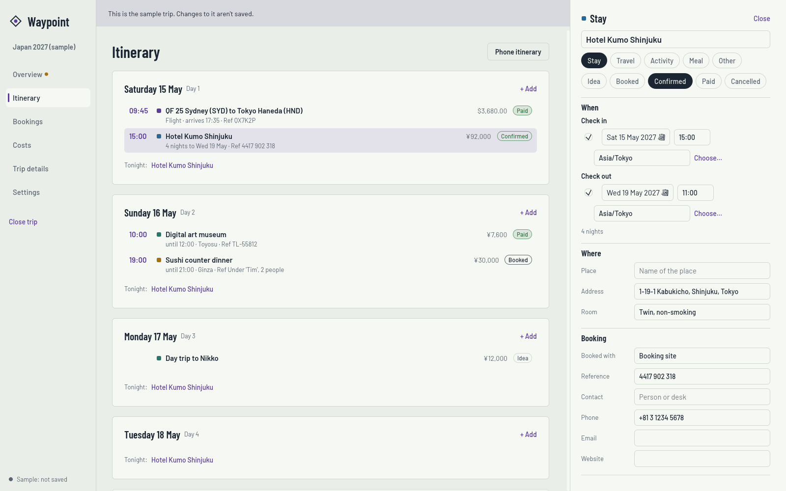
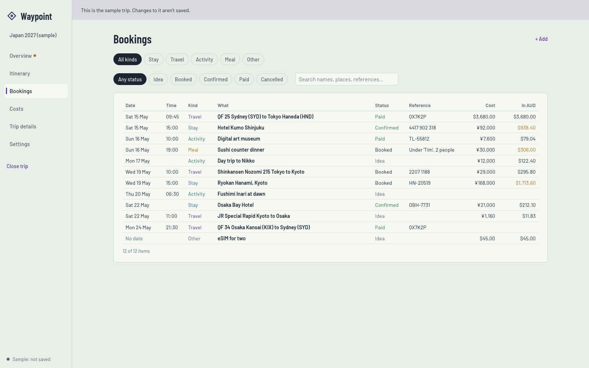
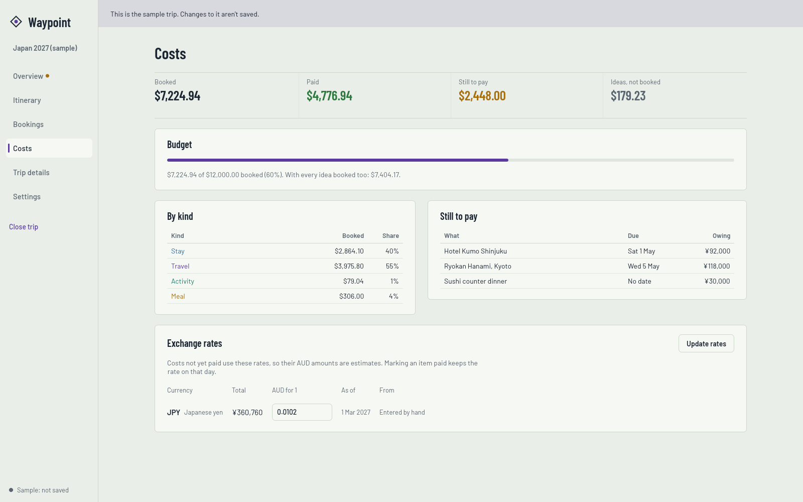
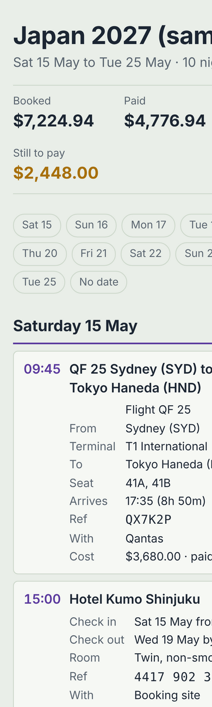

# Waypoint

A holiday planner for Windows and Linux. Each trip is laid out day by day: where you're staying each night, how you're getting about, what you're doing, booking references and who to call, what everything costs, and how far along each booking is (idea, booked, confirmed, paid).

Each trip is one file. Keep it in your Google Drive folder and it's backed up and shared. Every time Waypoint saves, it also writes a **phone itinerary** beside it: a single page you can open on an iPhone from the Files app, with no signal needed.

It's one program: a single `waypoint.exe` on Windows, a single `waypoint` file on Linux.



## Getting it

**Download:** the [Releases page](../../releases) has the latest build: `waypoint-windows-x64.exe` and `waypoint-linux-x64.tar.gz`.

- **Windows:** double-click `waypoint-windows-x64.exe`. Windows SmartScreen may say it doesn't recognise the app, because it isn't code-signed. Choose **More info**, then **Run anyway**.
- **Linux:** `tar xzf waypoint-linux-x64.tar.gz`, then `./waypoint`.

**Look around first:** choose **Look at the sample trip** (or start it as `waypoint --sample`): ten made-up days in Japan, partly booked, with one night still to find.

## Keeping trips in Google Drive

Waypoint doesn't sign in to Google itself; it saves to a folder that Google Drive keeps in sync.

- **Windows:** install [Google Drive for desktop](https://www.google.com/drive/download/). Your Drive appears as a drive letter (usually `G:`). Make a `Trips` folder in it and create your trips there.
- **Linux:** Google doesn't make a Drive app for Linux. [rclone](https://rclone.org/drive/) can keep a local folder in step with Drive (`rclone bisync`), or mount it (`rclone mount`); paid apps such as Insync also work. Point Waypoint at that folder.
- **iPhone:** in the Files app, Google Drive appears under Locations once the Google Drive app is installed. Open `Your trip.html` from there. Mark it "Available offline" in the Drive app before you fly.

**Two people, one trip.** If someone else has the trip open, Waypoint says so. Changes saved on another computer are taken in by themselves when you have nothing unsaved. If you both changed it, Waypoint asks: load theirs (yours is kept as a copy beside it) or save yours over theirs. It never quietly overwrites.

## Screens

- **Overview**: how long until you go, what's booked, paid and still to pay against your budget, and what needs a look: nights with nowhere to stay, two places booked for one night, bookings that overlap, balances falling due in the next two weeks, free cancellation ending in the next week, booked travel and stays with no reference.
- Anything under To look at that's fine as it is (a drive with no booking reference, say) can be marked **OK** so it stops showing; marked ones can be shown again and undone.
- **Itinerary**: each day in time order, with "Tonight:" showing where you sleep. **+ Add** on a day adds a stay, travel, activity, meal or anything else on that day.
- **Bookings**: every item in one table, filtered by kind and status, or searched by name, place or reference.
- **Costs**: totals, the budget, cost by kind, what's still owing and when, and the exchange rates.
- **Trip details**: the stage (Planning or Booking: while planning with nothing booked, moving the first day moves the whole trip), name, dates, home currency, budget, who's going, notes.

**Time zones.** Journeys take their time zones from where they leave and arrive ("Melbourne", "MEL", "Houston (IAH)", "Kyoto"), from lists of airports and towns built into Waypoint; set a zone yourself only for a place it doesn't know. Everything else takes its zone from the journeys: at home before the first, then wherever each one lands. Items are shown in the order they really happen, flight lengths allow for the time difference, flights over the date line that cover two nights count for both, and bookings in another zone show the time at home too. If a time without a zone could be in two places (flying east over the date line repeats part of a day), Waypoint asks you to set one.

Click any item to open it on the right. Changes save by themselves a moment after you stop typing.



## Money and exchange rates

Each cost is kept in the currency you'll pay it in (yen for a Tokyo hotel) and shown in your home currency (AUD by default). Items not yet paid use the trip's current rate, so their AUD figure is an estimate. **Marking an item Paid keeps the rate on that day**, so paid items stop moving with the exchange rate.

**Update rates** on the Costs screen fetches today's rates from [Frankfurter](https://frankfurter.dev) (the European Central Bank's reference rates) and, for currencies it doesn't cover, [ExchangeRate-API](https://www.exchangerate-api.com)'s free rates. Neither needs an account or key. Waypoint only goes online for rates when you ask, or if you switch on "Update exchange rates when a trip opens" in Settings. You can always type a rate in.



## The phone itinerary



One page, named after the trip, written beside the trip file each time it saves (switch it off in Settings). It has every day, each booking's times, reference, address (tap for Maps), phone (tap to call) and what's still owing, and marks today. No scripts and nothing fetched from the internet. It follows the phone's light or dark setting.

<br clear="right">

## Places as you type

Switch on **Suggest places** in Settings and, as you type a hotel, restaurant or sight's name, Waypoint lists matching places from [OpenStreetMap](https://www.openstreetmap.org) (searched through [Photon](https://photon.komoot.io)). Picking one fills in the name and address, and the time zone if the booking has none. It's off until you switch it on.

## PDFs

**Save PDF** on the Itinerary (or Trip details) makes a PDF of the itinerary, either everything or the version to share below, without going through a browser.

## An itinerary to share

**Itinerary to share** (on the Itinerary and Trip details screens) writes `Japan 2027 (to share).html` beside the trip and opens it in your browser: every booked flight, train, stay and activity with times, addresses, phone numbers and home times, and nothing private (no costs, booking references, who it's booked with, contacts, seats, rooms, notes, ideas or cancellations). Send it as it is, or print it from the browser and choose **Save as PDF**.

## The trip file

`Japan 2027.trip.json` is plain JSON, so you can read it in any text editor, and Google Drive keeps its version history. While a trip is open, `Japan 2027.trip.lock` beside it says who has it open; it's removed when Waypoint closes.

Fields Waypoint doesn't know (from a newer version) are kept when it saves, so two people on different versions don't lose each other's data. A file from a much newer Waypoint won't open, and Waypoint says so.

## Building it

```sh
cargo run -- --sample        # the sample trip
cargo test --workspace
```

Linux needs `libxkbcommon-dev libwayland-dev libgl1-mesa-dev` to build. `crates/waypoint-core` holds everything that doesn't need a window (the trip model, money, checks, files, rates, the phone page) and is unit tested; `src/` is the window. `cargo run -p waypoint-core --example phone_page -- out.html` writes the sample's phone page.

Airport and airline lists are from [OpenFlights](https://openflights.org/data) (Open Database License); towns and their time zones from [Natural Earth](https://www.naturalearthdata.com) (public domain) via the city-timezones package. `crates/waypoint-core/data/build_places.py` rebuilds them.

The look comes from [Isobar](https://github.com/TimsterAudio/Isobar): pale paper, slate ink, a violet pen, and the Barlow fonts (SIL Open Font License, in `assets/fonts`).
